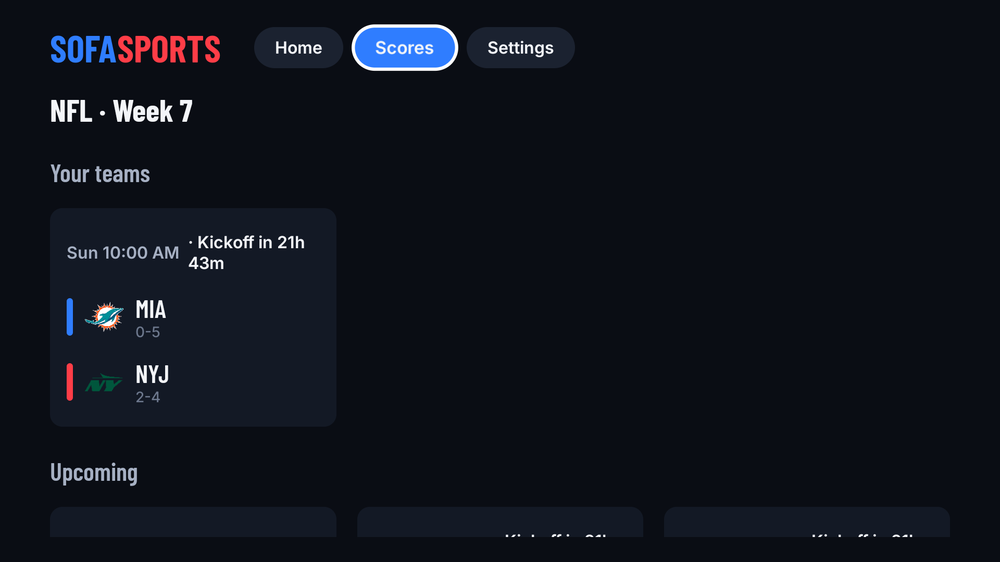

# Sofa Sports

NFL scores, fantasy and a live score overlay for Android TV / Google TV.

- **Scores**: your favorite teams first, then live, upcoming and final games, updated every 30 s while games are live. Close games are flagged.
- **Game Center**: win probability, box score, play-by-play and DraftKings lines.
- **Fantasy**: your Sleeper (username only) and ESPN Fantasy leagues, with a live matchup card.
- **Picks**: track PrizePicks and DraftKings picks you enter on the TV, live from ESPN box scores.
- **Overlay**: a small corner card over whatever you're watching (your matchup, a pinned game, your picks), plus an optional news ticker.

Blue is always you (your team, your fantasy side) and red is the opponent.



## Install

1. Download the latest APK: https://github.com/gitzero-io/sofasports/releases/latest/download/sofasports.apk
2. On the TV, turn on Developer options and **Network debugging** (Settings → System → About → tap *Android TV OS build* 7 times).
3. From a computer with [adb](https://developer.android.com/tools/releases/platform-tools):

   ```sh
   adb connect <TV_IP>:5555
   adb install -r sofasports.apk
   # allow the score overlay (TVs have no settings screen for this)
   adb shell appops set com.sofasports.tv SYSTEM_ALERT_WINDOW allow
   ```

The app checks for new versions itself and shows a QR code with the download link when one is out.

## Build

Open in Android Studio, or:

```sh
./gradlew assembleDebug test
```

Optional settings go in `local.properties` (never committed): `sentry.dsn`, `sofa.configUrl`, `sofa.versionUrl`, `sofa.feedbackUrl`, and the `release.*` signing keys. The app runs fine without any of them. Debug builds include offline fixtures (Settings → Data source → Fixtures).

`release-assets/config.json` (remote config and kill switch) and `release-assets/version.json` (update check) are read by the app straight from this repo's `main` branch.

## Notes

Not affiliated with or endorsed by the NFL, ESPN, Sleeper, DraftKings or PrizePicks. Data comes from public ESPN and Sleeper endpoints, some of them unofficial, and can break without notice. Fonts: Barlow Condensed and Inter (SIL OFL, see `licenses/`).
